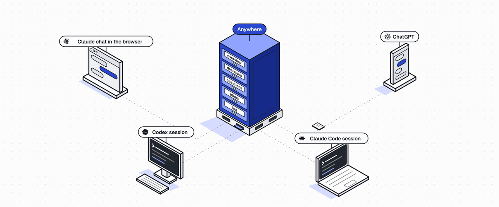
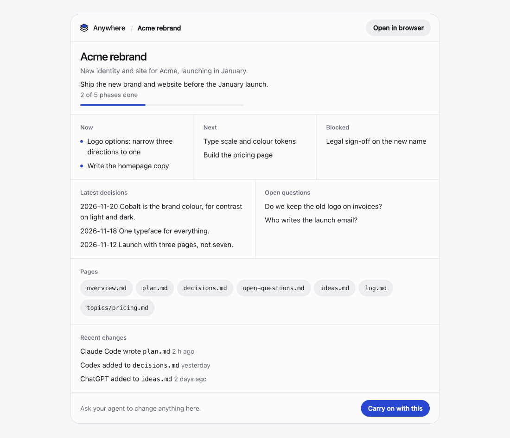
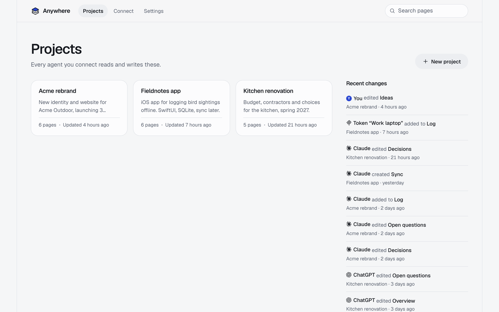
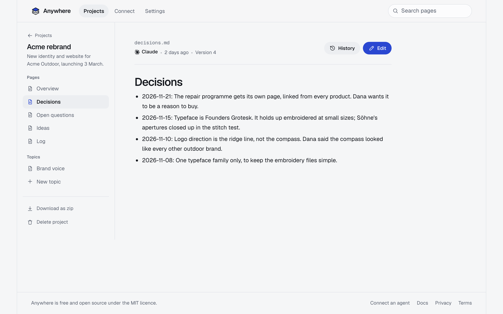
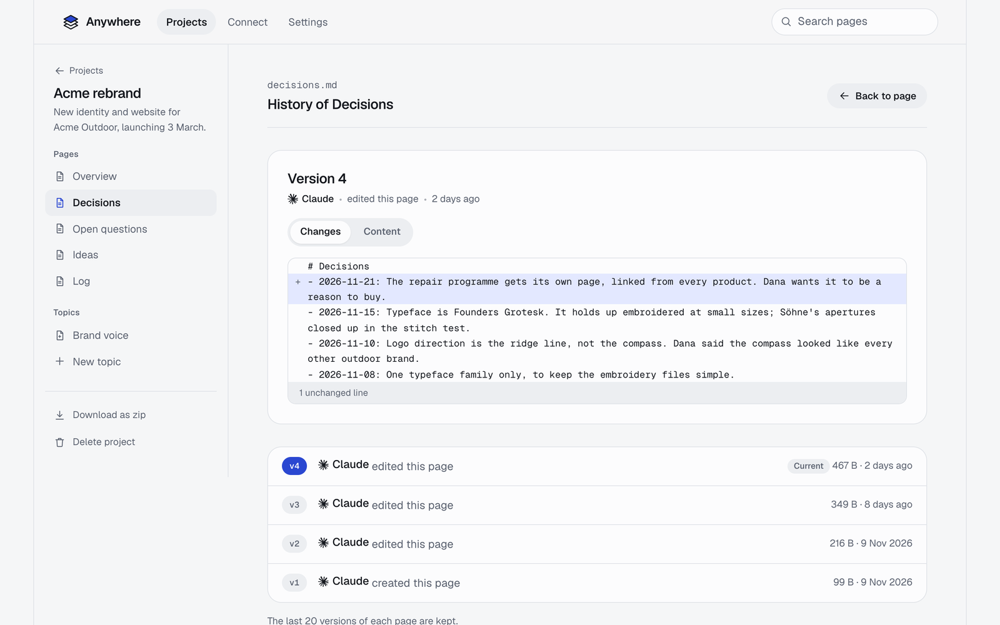
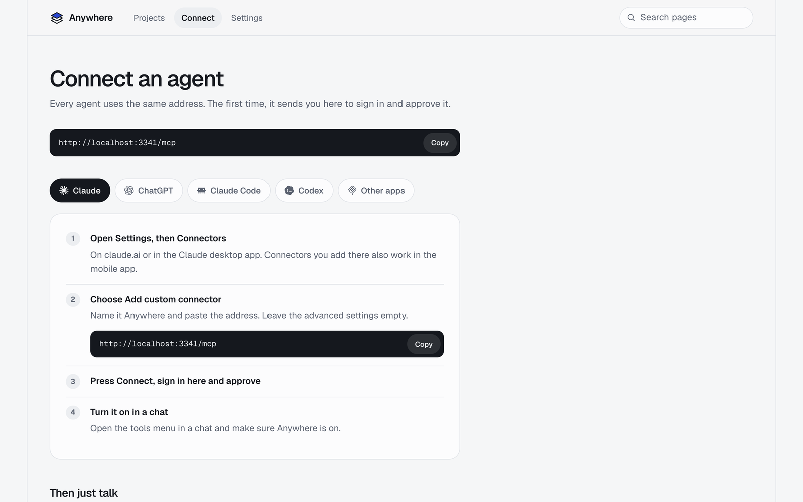

<h1 align="center">
  <picture>
    <source media="(prefers-color-scheme: dark)" srcset="docs/images/mark-dark.svg">
    
  </picture>
  Anywhere
</h1>

<p align="center"><strong>Every agent, one memory.</strong></p>

<p align="center">
Claude, ChatGPT, Claude Code and Codex read and write the same project pages.<br>
Decide something in one of them, and every agent you use knows it the next time it starts.
</p>

<p align="center">
  <a href="LICENSE"></a>
  <a href=".nvmrc"></a>
  <a href="https://modelcontextprotocol.io"></a>
  <a href="https://github.com/ethanplusai/anywhere/actions/workflows/ci.yml"></a>
</p>

**Prefer not to run it yourself? [anywr.ai](https://anywr.ai) is the hosted version of Anywhere, and it is free.**

<p align="center">
  <picture>
    <source media="(prefers-color-scheme: dark)" srcset="docs/images/hero-dark.gif">
    
  </picture>
</p>

## Why it exists

You brainstorm a project in Claude chat, build it in Claude Code, ask ChatGPT for a second opinion and hand a task to Codex. Each of them remembers its own conversations and none of them can see the others. So you paste the same background into every new session, and decisions made in one place quietly go missing in the next.

Anywhere gives all of them one place to keep a project's context: a few markdown pages that every agent reads before it starts and updates when something is decided. It is an MCP server, so any agent that speaks MCP can use it, and you use it by talking:

> Start a project called Acme rebrand in Anywhere.
>
> Add this decision to Anywhere, with the reason.
>
> Check Anywhere for what we decided about pricing.

## Your agent is the interface

You do not learn a new app to use Anywhere. You talk to the agent you already use, and Anywhere shows up inside that conversation: the hosted version and the one you run yourself work the same way.

> Show me my projects in Anywhere.
>
> Set up Anywhere.
>
> Show me the decisions for Acme rebrand.

In apps that can draw panels ([MCP Apps](https://modelcontextprotocol.io/docs/extensions/apps): Claude, ChatGPT and the Claude Code desktop app among them), the answer is Anywhere's own interface in the chat: your projects, a project's plan with what is happening now and next, a page to read, or a checklist of projects to bring in. You open a project or a page by clicking it, and anything you want changed you ask for. In a terminal, or any app that cannot draw panels, the agent gets the same content as text and tells you.



There is still a web app, for when you want a full window: reading history, editing by hand, connecting agents and exporting.

## How it works

Every project is the same small set of pages, so a chat agent and a coding agent file things in the same places:

| Page | Holds |
| --- | --- |
| `overview.md` | What the project is, who it is for, the goals and the current state. Every agent reads it first. |
| `plan.md` | Where the work stands: the goal, the phases, what is happening now, what is next and what is blocked. |
| `where.md` | Where it lives: the code, where it runs and how it is deployed, the services it uses and how the parts connect. |
| `rules.md` | How to work on it: conventions, what never to do and who approves what. |
| `decisions.md` | Decisions, newest first, each with a date and the reason. |
| `open-questions.md` | What is still undecided. Settled questions move to decisions. |
| `ideas.md` | Brainstorms nobody has committed to. |
| `log.md` | Short dated notes on what each session did. Append only. |
| `topics/<name>.md` | One page per subject that outgrows the pages above. |

The rules agents follow are written once, in [docs/layout.md](docs/layout.md), and served by the MCP server itself, so an agent learns how to keep the pages tidy just by connecting. The optional [skill](skill/README.md) teaches the same rules to coding agents ahead of time.

- **Versioned writes.** Every write names the version it read. If another agent changed the page in between, the write is refused and the agent merges and tries again, so nothing is silently overwritten.
- **Who changed what.** Each version records which app or token made it. The web app shows the change history per page, with a line-by-line diff and one-click restore.
- **Plain files when you want them.** The `anywr` command mirrors a project into a git-ignored `.anywhere/` folder in your repository and syncs it both ways, so coding agents can read the pages as files.
- **Yours to take.** Download any project as a zip of markdown, or delete a project or your whole account, at any time.

## Getting started with lots of projects

Say **"set up Anywhere"** to Claude Code or Codex (with the [skill](skill/README.md) installed). It asks first, then lists the projects on your computer, most recently active first, from your Claude Code and Codex sessions and your git folders. It reads folder names and dates only. You pick which ones to bring in, and for each it drafts the overview, plan, decisions and open questions from the project's README, `CLAUDE.md`, `AGENTS.md` and plan documents, marked so you know what to check.

In Claude chat or ChatGPT the same request is a short conversation about what you are working on.

## Switching agents mid-build

Hit a usage limit halfway through a long build? Open another account or another provider and say **"pick up where we left off on the build in Anywhere"**. The agent calls `resume`, gets the plan's Now and Next, and carries on. Agents keep `plan.md` current as they work, before long steps especially, so a session that is cut off still leaves the next one in the right place.

## The web app

Agents do most of the writing, and most of the showing. The web app is the full window: where you read history, fix a page by hand, and connect new agents.



Each project opens with its pages in a sidebar. You can read, edit, add topic pages, search across everything and download a project as markdown.



History shows every kept version of a page, who made it and exactly what changed.



## Quick start

### Use the hosted version

Request access at [anywr.ai](https://anywr.ai), then add the MCP address to your agents:

```
https://mcp.anywr.ai/mcp
```

### Ask your agent to do it

In Claude Code or Codex, say:

```
Install Anywhere from https://github.com/ethanplusai/anywhere and connect yourself to it. Follow docs/install-for-agents.md in that repository.
```

It starts Anywhere on your computer, connects itself and tells you when to open a new session.

### Run it on your own computer

For one person, with nothing to sign up for. You need Node.js 22 and pnpm.

```sh
git clone https://github.com/ethanplusai/anywhere.git
cd anywhere
pnpm install
pnpm local
```

It prints a link that opens the app. There, press **Connect** beside Claude Code or Codex: it adds this Anywhere to the agent and installs the skill, with nothing to paste. Then open a new session and say "Set up Anywhere". It listens on this computer only (`127.0.0.1:3341`), refuses requests that name another host or come from another website, and has no accounts: the browser is unlocked with a token from an owner-only file, which is replaced each time it is used, and agents send a second token as a header. Your pages and both tokens live in `~/.anywhere`, and nothing is limited: the quotas of a shared server do not apply on your own computer. To open the app again later:

```sh
open "http://127.0.0.1:3341/local/unlock#token=$(cat ~/.anywhere/browser-token)"
```

Claude chat and ChatGPT run in the cloud and cannot reach a server on your computer; use the hosted Anywhere or a server of your own for those.

### Run it yourself with Docker

You need Docker. From a clone of this repository:

```sh
git clone https://github.com/ethanplusai/anywhere.git
cd anywhere
cp .env.example .env   # set BASE_URL and POSTGRES_PASSWORD
docker compose up -d
```

Open `BASE_URL`, create your account, and connect your agents to `BASE_URL/mcp`. Anything beyond localhost needs a TLS proxy in front: Claude's connectors require `https`. Every setting is documented in [packages/server/README.md](packages/server/README.md).

### Try it locally with demo data

You need Node.js 22 and pnpm. This seeds three projects written by several agents into an embedded database, so you can click through every view without connecting anything:

```sh
pnpm install
pnpm --filter ./packages/server build
node packages/server/scripts/demo.mjs
ANYWHERE_PGLITE_DIR=packages/server/.demo ANYWHERE_ALLOW_EMBEDDED_DB=1 PORT=3341 node packages/server/dist/main.js
```

Open http://localhost:3341 and sign in with the details in `packages/server/.demo/credentials.txt`.

## Connect your agents

Every agent uses the same address. The first time, it opens Anywhere in your browser to sign in and approve it.



**Claude** (claude.ai, desktop and mobile): Settings, Connectors, **Add custom connector**, paste the address, then Connect.

**ChatGPT**: Settings, Apps & Connectors, turn on Developer mode under Advanced settings, then **Create** a connector with the address and OAuth.

**Claude Code**:

```sh
claude mcp add --transport http anywhere https://mcp.anywr.ai/mcp
```

Then run `/mcp` inside Claude Code, pick `anywhere` and choose **Authenticate**.

**Codex**:

```sh
codex mcp add anywhere --url https://mcp.anywr.ai/mcp
codex mcp login anywhere
```

**Anything else**: any client that speaks MCP over Streamable HTTP with OAuth can use the address directly. Clients that can only send a fixed header can use a personal access token as `Authorization: Bearer <token>`.

For your own server, use `BASE_URL/mcp` (or `ANYWHERE_MCP_ORIGIN/mcp` if you gave MCP a host of its own).

## MCP tools

| Tool | What it does |
| --- | --- |
| `guide` | How projects are organised and the rules for writing, from [docs/layout.md](docs/layout.md). |
| `list_projects` | Your projects, most recently changed first. |
| `create_project` | A new project with its standard pages, its group and its repositories. |
| `update_project` | Rename a project, move it to another group, pause or archive it, or list its repositories. |
| `get_project` | A project's pages with their first lines, and `overview.md` in full. |
| `resume` | A short briefing to carry on: current state, the plan's Now and Next, recent decisions, open questions and who changed what. |
| `read_page` | One page and its version. |
| `write_page` | Replace a page, naming the version you read. |
| `append_to_page` | Add to the end of a page, such as `log.md`. |
| `delete_page` | Delete a topic page. Standard pages can be emptied but not deleted. |
| `search` | Full-text search across one project or all of them. |
| `show_projects` | Shows the person all their projects and the latest changes across them. |
| `show_project` | Shows the person where a project stands: the plan's Now, Next and Blocked, the latest decisions, open questions, its pages and recent changes. |
| `show_page` | Shows the person one page, formatted, for reading. |
| `choose_projects` | Shows the person a checklist of projects to bring in when setting up. Their choice comes back as their next message. |

The last four draw Anywhere's interface in the conversation in apps that support [MCP Apps](https://modelcontextprotocol.io/docs/extensions/apps), such as Claude, ChatGPT and the Claude Code desktop app. It is one self-contained page (`packages/server/src/mcp/panels.ts`) that moves between views in place by calling the same tools. Everywhere else the agent gets the same content as text.

Page content returned to agents is wrapped in clear markers, so instructions someone wrote into a page are read as data rather than followed.

## The repository mirror

The `anywr` command keeps a project's pages as plain files in your repository, for coding agents that work best with files. Install it from this repository:

```sh
pnpm install && pnpm --filter anywr build && npm install -g ./packages/cli
```

```sh
anywr login https://app.anywr.ai   # with a personal access token from Settings, Tokens
anywr link acme-rebrand            # mirror into .anywhere/, git-ignored
anywr pull                         # fetch what other agents changed
anywr push                         # send your edits; conflicts become .remote.md files
```

The contract between the CLI and the server is [docs/api.md](docs/api.md).

## Security

Anywhere holds people's working notes and is connected to agents that act on their behalf, so it is built defensively:

- OAuth 2.1 with PKCE, dynamic client registration and client metadata documents. The approval page names where an app sends you back to and warns when an unverified app uses a well-known name.
- Tokens and passwords are stored only as hashes. Connections expire after 90 days and can be disconnected at any time.
- Rate limits per address, per account and per user, quotas per account, and a strict content security policy on every page.
- Page content is sanitised when rendered, remote images are never loaded, and content returned to agents is marked as data.

The full audit and what was fixed are in [docs/security](docs/security). To report a vulnerability, see [SECURITY.md](SECURITY.md).

## Repository layout

| Path | What it is |
| --- | --- |
| [`packages/server`](packages/server) | The MCP server, OAuth server, sync API and web app (TypeScript, Hono, Postgres). |
| [`packages/cli`](packages/cli) | The `anywr` command that mirrors a project into a folder. |
| [`skill/anywhere`](skill) | The agent skill for Claude Code and Codex. |
| [`docs/layout.md`](docs/layout.md) | How a project is organised. The single source for the server, the skill and the docs. |
| [`docs/api.md`](docs/api.md) | The HTTP contract between the server and the CLI. |
| [`docs/security`](docs/security) | The security audit and its fixes. |

## Development

```sh
pnpm install
pnpm test        # server and CLI tests, against an embedded Postgres
pnpm lint
pnpm typecheck
pnpm build
```

Tests need no network and no database server. See [CONTRIBUTING.md](CONTRIBUTING.md) before opening a pull request, and [ROADMAP.md](ROADMAP.md) for what is planned.

## License

[MIT](LICENSE). The bundled Geist fonts and agent logos keep their own licences; see [THIRD_PARTY_NOTICES.md](THIRD_PARTY_NOTICES.md).
